<div align="center">

# HALO

**Design systems, icons & fonts in one app.**<br>
A cinematic, scroll-driven product site for a design tool, with real WebGL, live interactive demos and a generative soundtrack.

**[▶ Live site](https://YOUR-USERNAME.github.io/YOUR-REPO/)** · **[🎬 Showreel](https://github.com/YOUR-USERNAME/YOUR-REPO/releases)** · **[📱 Reel preview](media/halo-reel-preview.mp4)**

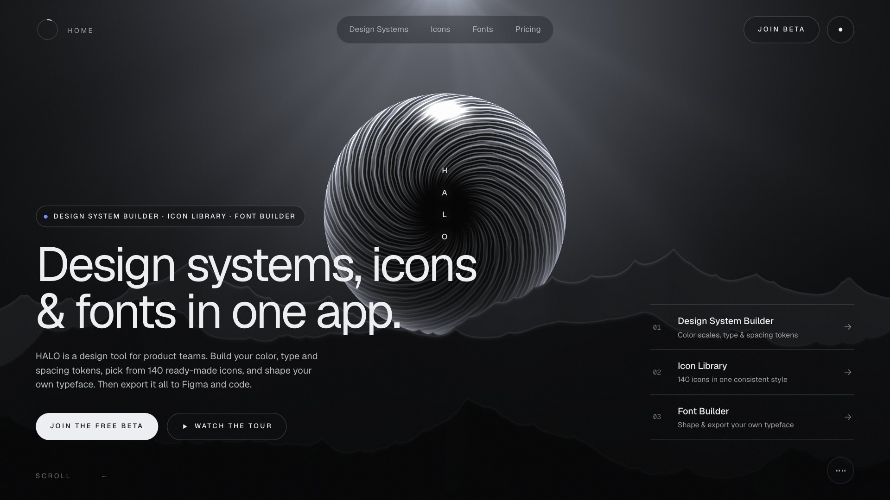

</div>

---

## What it is

HALO is a concept product: one studio for a **Design System Builder**, an **Icon Library** and a **Font Builder**.
The site is built to feel like a film you scroll through. The orb becomes a moon, moons become an eclipse,
and every product chapter is a live tool you can actually use.

| | |
|---|---|
| 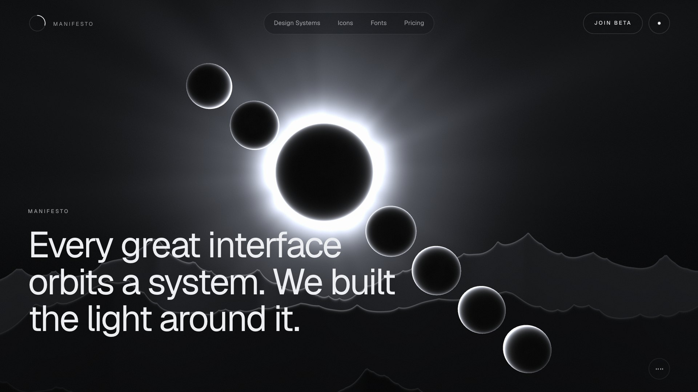 | 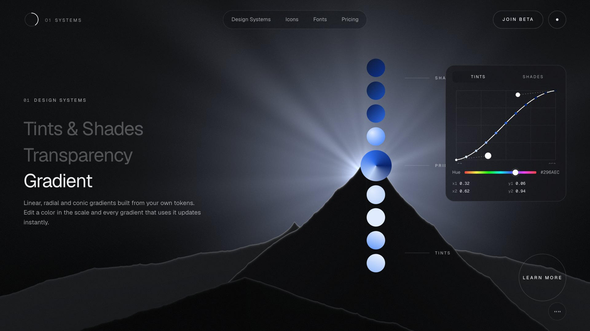 |
| 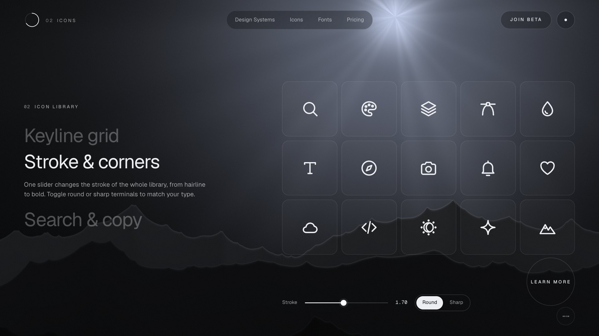 | 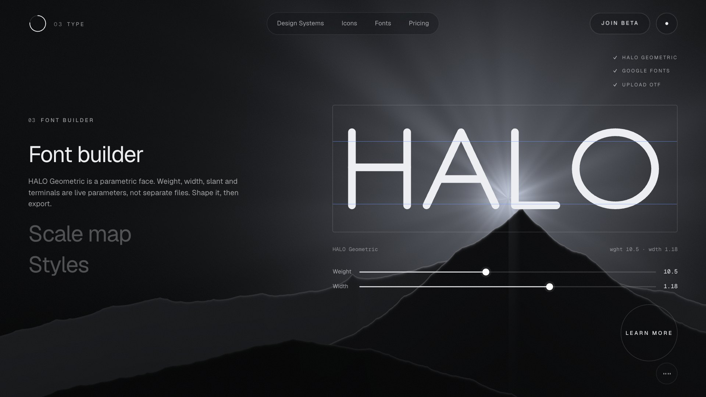 |

## Try it

| Page | What you can do |
|---|---|
| **Home** | Scroll the story, drag the color curve, change the grid columns, restyle icons with one slider, morph the parametric typeface |
| **Design Systems** | Generate OKLCH color scales with contrast badges, tune type, spacing and radius, watch live light/dark components update, and export **CSS / JSON / Tailwind** |
| **Icon Library** | Search 140 original icons, filter by category, set stroke, size, corners and color, then copy or download clean SVG |
| **Font Builder** | Shape *HALO Geometric* (weight, width, slant, spacing, terminals), browse the character map, play with variable-font axes, build a type scale |

| | | |
|---|---|---|
| 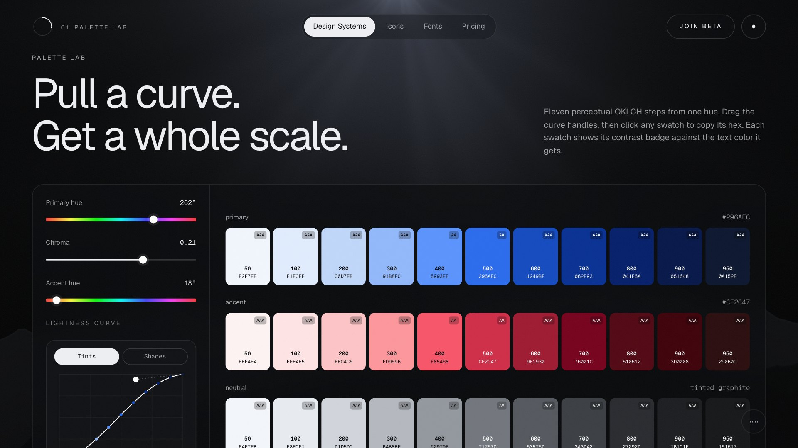 | 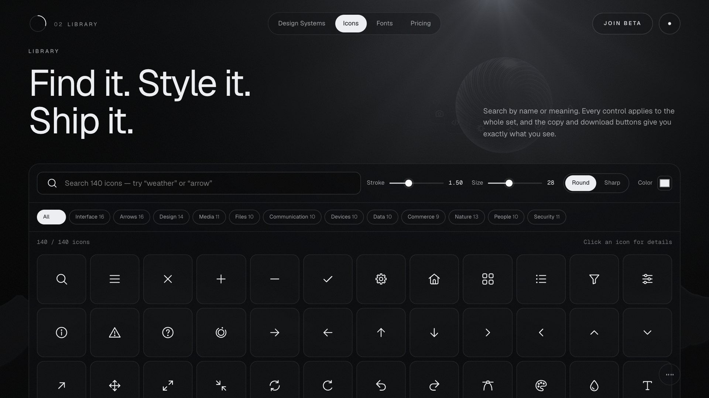 | 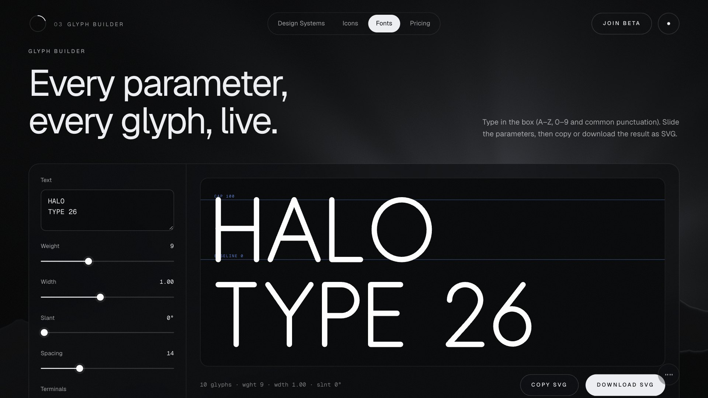 |

<p align="center">
  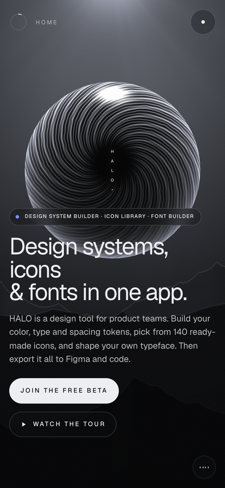
  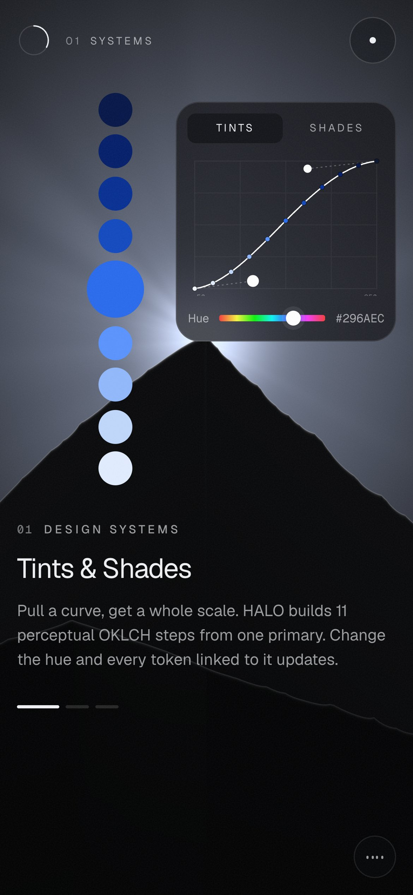
  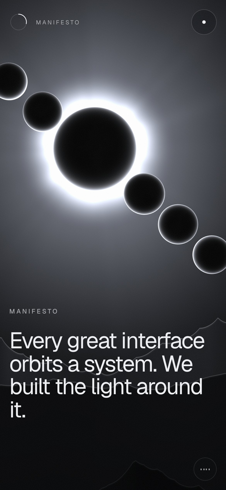
  <a href="media/halo-reel-preview.mp4">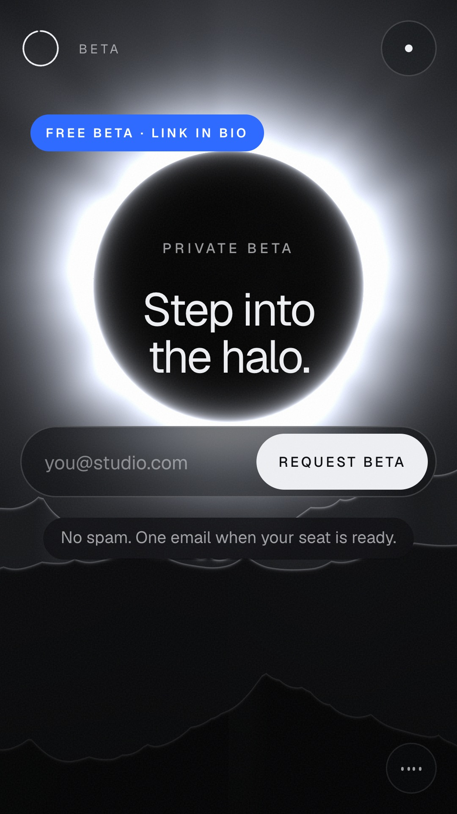</a>
</p>

## Highlights

- **One WebGL stage** behind every page: a sky and spotlight shader, procedural mountains with rim light, an iris orb that turns into a cratered moon, an eclipse corona, a cube and a radial gear, all driven by scroll-keyed keyframes.
- **Pinned scroll chapters** with GSAP ScrollTrigger + Lenis smooth scrolling, and words that light up as you read.
- **Smooth by design:** every interaction eases in and out. There are no springs, bounces or hard swaps, and content changes crossfade.
- **Live tools, not mockups:** OKLCH color math, a parametric skeleton typeface rendered to SVG, and a 140-icon original set on a 24 px keyline grid.
- **Generative soundtrack** (off by default, bottom-right): a WebAudio score in D dorian that reacts to how fast you scroll.
- **Accessible & responsive:** phone, tablet and desktop layouts, Calm mode for reduced motion (follows the OS setting), labelled controls and readable contrast.

## Run it locally

It's plain HTML, CSS and JavaScript with no build step. It has to be served over http because it uses ES modules:

```bash
python3 -m http.server 4321
```

Then open <http://localhost:4321>. On a Mac you can also double-click **`Launch HALO.command`**.

## Project structure

```
index.html  systems.html  icons.html  fonts.html
css/halo.css            design tokens, components, responsive + calm-mode rules
js/core.js              chrome, smooth scroll, cursor, menu, preloader, page transitions, calm mode
js/stage.js             the WebGL stage (Three.js + custom shaders)
js/director.js          scroll-keyed keyframes for the stage
js/home.js …            page choreography (home, systems, icons-page, fonts-page)
js/demos.js             live demos · js/color.js OKLCH math · js/type-render.js glyph renderer
js/score.js             generative soundtrack (live + offline render)
js/data/                the 140 icons and the parametric font skeletons
docs/                   site map and motion plan
media/                  screenshots and the reel preview
tools/video/            frame-perfect capture + encoding toolkit used for the showreel and reel
```

## Built with

[Three.js](https://threejs.org) · [GSAP + ScrollTrigger](https://gsap.com) · [Lenis](https://lenis.darkroom.engineering) · [Geist & Geist Mono](https://vercel.com/font) · [Roboto Flex](https://fonts.google.com/specimen/Roboto+Flex). Libraries and fonts load from public CDNs.

The icons, the HALO Geometric typeface, the shaders and all copy are original to this project.
HALO is a portfolio concept, not a real product.
